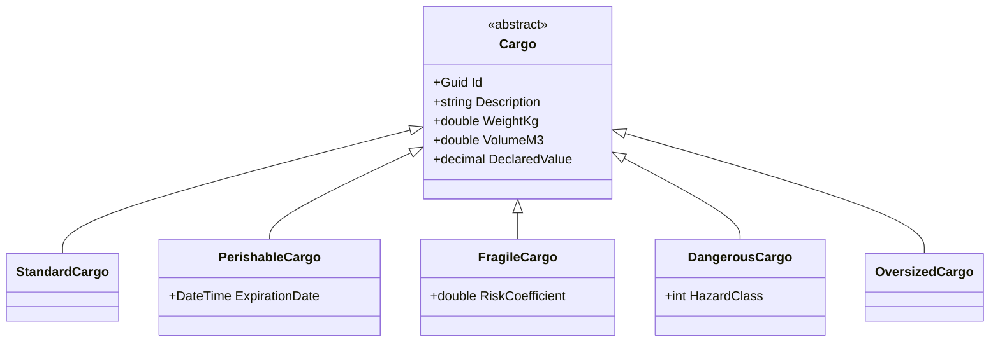

# LogiCore — Ядро информационной системы транспортно-логистической компании

Данный проект представляет собой объектную модель и бизнес-логику для системы управления грузоперевозками. Проект разработан в рамках задания по ООП и демонстрирует применение принципов SOLID, паттернов проектирования и современных возможностей C# (.NET 8).

## Архитектура решения

Решение разделено на слои (проекты):

+ **`LogiCore.Domain`** — ядро системы. Содержит доменную модель (ТС, Грузы, Заказы), бизнес-правила, интерфейсы и сервисы. Не зависит от консоли (Console) и внешних библиотек.
+ **`LogiCore.App`** — консольное приложение. Содержит интерактивное меню, демо-сценарий, подписчиков на события и отчеты.
+ **`LogiCore.Tests`** — проект с юнит-тестами (xUnit), покрывающий бизнес-логику, расчеты, валидацию и сериализацию.

## UML-диаграмма классов (основные иерархии)
Блок 1 - (Транспрорт):

Блок 2 (Грузы):



## Соответствие требованиям (ТЗ)
| Требование | Где реализовано (Класс / Файл) | Описание |
| :--- | :--- | :--- |
| **T1. Инкапсуляция** | `Order.cs`, `Vehicle.cs`, `Customer.cs` | Приватные сеттеры статуса заказа, `IReadOnlyCollection` для истории заказов и грузов. Валидация в конструкторах. |
| **T2. Наследование и полиморфизм** | `Vehicle.cs`, `Cargo.cs` | Абстрактные методы `CalculateDeliveryCost`, `sealed` класс `DroneCourier`, `base.CanCarry()` в наследниках. |
| **T3. Интерфейсы и вариантность** | `Contracts.cs`, `PerishableCargo.cs` | Ковариантный `IReadOnlyRepository<out T>`, контравариантный `IValidator<in T>`. Явная реализация `ITemperatureSensitive` в `PerishableCargo`. |
| **T4. Обобщения и коллекция** | `Repository.cs` | `Repository<T> where T : IEntity`, `yield return` в итераторе, индексатор, `ToReportTable()` (метод расширения). |
| **T5. Делегаты и события** | `DomainEvents.cs`, `Subscribers.cs` | Свой делегат `OrderStatusChangedHandler`, 4 события, 2 подписчика (`ConsoleNotifier`, `FileLogger`), демонстрация отписки. |
| **T6. Исключения** | `LogisticsExceptions.cs` | Иерархия от `LogisticsException`, фильтры `when`, повторный проброс `throw;`, `using` для FileLogger. |
| **T7. Паттерны** | `Services`, `Decorators`, `Factories` | Strategy (`ITariffStrategy`), Decorator (`IDeliveryCost`), Factory Method (`VehicleFactory`), Observer (события), Singleton (`TariffConfig`). |
| **T8. LINQ** | `ReportGenerator.cs` | 6 отчетов: `GroupBy`, `Join` (синтаксис запросов), `OrderByDescending`, `ToDictionary`, агрегаты. |
| **T9. Сериализация** | `StateManager.cs`, `StateDto.cs` | Сохранение в JSON через плоские DTO, обработка отсутствующего и битого файла. |
| **T10. Enum и структуры** | `Vehicle.cs`, `RoutePoint.cs` | `struct RoutePoint` с перегрузкой `-` и `explicit operator string`. Перечисление статусов/состояний. |

## Паттерны проектирования (T7)
+ Strategy — **`ITariffStrategy`** (тарифы: Standard, Express, Heavy).
+ Decorator — **`IDeliveryCost`** (Страхование, Срочность, Упаковка).
+ Factory Method — **`VehicleFactory`**, CargoFactory (создание по строковому типу).
+ Observer — События в **`DeliveryService`** (подписка/отписка).
+ Singleton — **`TariffConfig`** (потокобезопасная конфигурация через **`Lazy<T>`**).

## Принципы SOLID (примеры из кода)
+ S (Single Responsibility): **`CargoCompatibilityValidator`** отвечает только за проверку совместимости, а не за создание заказов.
+ O (Open/Closed): Добавление новых типов транспорта не требует изменения **`DeliveryService`** (он работает через базовый класс **`Vehicle`**).
+ L (Liskov Substitution): Любой наследник **`Vehicle`** корректно работает в **`DeliveryService`** (через **`CanCarry`** и **`CalculateDeliveryCost`**).
+ I (Interface Segregation): Разделение интерфейсов **`ITemperatureSensitive`**, **`IInsurable`**, **`IStackable`**.
+ D (Dependency Inversion): **`DeliveryService`** зависит от интерфейса **`IValidator`**, а не от конкретного **`CargoCompatibilityValidator`**.

## Запуск и тестирование
Для запуска демо-сценария и интерактивного меню:
```bash
dotnet run --project LogiCore.App
```
Для запуска тестов:
```bash
dotnet test
```
