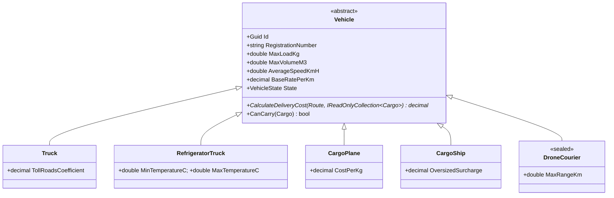
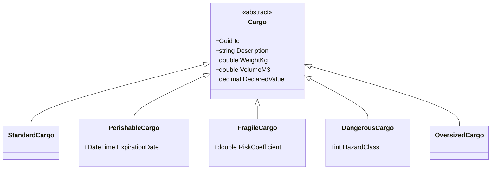

# LogiCore — Ядро информационной системы транспортно-логистической компании

Данный проект представляет собой объектную модель и бизнес-логику для системы управления грузоперевозками. Проект разработан в рамках задания по ООП и демонстрирует применение принципов SOLID, паттернов проектирования и современных возможностей C# (.NET 8).

## Структура решения

```text
LogiCore.slnx
LogiCore.Domain/          class library — доменная модель и бизнес-логика (без Console)
    Common/               IEntity, RoutePoint (struct), TariffConfig
    Exceptions/           LogisticsException и наследники
    Abstractions/         IValidator<in T>, IReadOnlyRepository<out T>, ITariffStrategy
    Cargo/                Cargo и 5 наследников, интерфейсы грузов
    Vehicle/              Vehicle и 5 наследников, VehicleState, [Flags] TransportConditions
    Order/                Customer, Route, Order (машина состояний)
    Decorators/           IDeliveryCost, BaseDeliveryCost, 3 декоратора услуг
    Events/               EventArgs и делегаты
    Factories/            VehicleFactory, CargoFactory
    Repositories/         Repository<T>, ToReportTable
    Services/             CargoCompatibilityValidator, DeliveryService (диспетчер)
LogiCore.App/             console app
    Demo/                 DemoData, DemoRunner, ReportGenerator
    Infrastructure/       ConsoleNotifier, FileLogger, StateManager, StateDto
    Menu.cs               интерактивное меню
    Program.cs            точка входа
LogiCore.Tests/           xUnit — 6 файлов с тестами
docs/uml.png              диаграмма классов (Mermaid)
```


## UML-диаграмма классов (основные иерархии)
Блок 1 - (Транспрорт):

Блок 2 (Грузы):



## Паттерны проектирования (T7)

| Паттерн | Где реализовано | Зачем применён |
| :--- | :--- | :--- |
| **Strategy** | `ITariffStrategy` (Abstractions) | Тариф выбирается во время работы, без `switch` в расчёте стоимости. |
| **Decorator** | `IDeliveryCost` (Decorators) | Услуги (страховка, срочность, упаковка) комбинируются в любом наборе и порядке. |
| **Factory Method** | `VehicleFactory`, `CargoFactory` (Factories) | Создание объектов по описанию (тип + параметры), скрывает логику конструкторов. |
| **Observer** | События в `DeliveryService`, подписчики в `Subscribers.cs` | Диспетчер не знает, кто реагирует на события (консоль, файл). |
| **Singleton** | `TariffConfig` (Common) | Одна конфигурация тарифов на приложение, потокобезопасная через `Lazy<T>`. |


## Соответствие требованиям (ТЗ)
| Требование | Где реализовано (Класс / Файл) | Описание |
| :--- | :--- | :--- |
| **3.1 Транспорт** | `Vehicle/` | Валидация номера, лимиты, `State`, абстрактный расчёт цены, 5 наследников, `sealed DroneCourier`. |
| **3.2 Грузы** | `Cargo/` | `Cargo` и 5 наследников, интерфейсы грузов, явная реализация `ITemperatureSensitive` в `PerishableCargo`. |
| **3.2 Валидация** | `Services/CargoCompatibilityValidator.cs` | Четыре правила совместимости в отдельном сервисе. |
| **3.3 Заказы** | `Order/` | `Customer` с историей, `Route`, `Order` как машина состояний (переходы только через методы). |
| **3.4 Диспетчер** | `Services/DeliveryService.cs` | Приём заказов, подбор самого дешёвого ТС, статусы, события, выручка. |
| **T1. Инкапсуляция** | `Vehicle.cs`, `Cargo.cs`, `Order.cs` | Нет публичных полей, проверки в конструкторах, наружу `IReadOnlyCollection`. |
| **T2. Наследование** | `Vehicle/`, `Cargo/` | `abstract` / `virtual` / `override`, `sealed`, вызовы `base.CanCarry`. |
| **T3. Интерфейсы** | `Abstractions/Contracts.cs` | Свои интерфейсы, явная реализация, ковариантность (`out T`) и контравариантность (`in T`). |
| **T4. Обобщения** | `Repositories/Repository.cs` | `Repository<T> where T : class, IEntity`, индексатор, `yield return`, `ToReportTable`. |
| **T5. События** | `Events/`, `DeliveryService.cs` | 4 события со своими `EventArgs`, свой делегат, 2 подписчика, отписка. |
| **T6. Исключения** | `Exceptions/`, `StateManager.cs` | Иерархия исключений, фильтры `when`, `using` и `finally` для файловых ресурсов. |
| **T7. Паттерны** | см. таблицу выше | Минимум 5 паттернов. |
| **T8. LINQ** | `Demo/ReportGenerator.cs` | 6 отчётов, один в синтаксисе запросов (`from ... select`), остальные — методы. |
| **T9. Сериализация** | `Infrastructure/StateManager.cs` | JSON через `System.Text.Json`, обработка отсутствующего/битого файла, DTO-снимок. |
| **T10. Enum и структуры** | `Vehicle.cs`, `RoutePoint.cs` | `[Flags] TransportConditions` с демонстрацией побитовых операций, `struct RoutePoint` с перегрузкой операторов. |


## Принципы SOLID (примеры из кода)
+ S (Single Responsibility): **`CargoCompatibilityValidator`** отвечает только за проверку совместимости, а не за создание заказов.
+ O (Open/Closed): Добавление новых типов транспорта не требует изменения **`DeliveryService`** (он работает через базовый класс **`Vehicle`**).
+ L (Liskov Substitution): Любой наследник **`Vehicle`** корректно работает в **`DeliveryService`** (через **`CanCarry`** и **`CalculateDeliveryCost`**).
+ I (Interface Segregation): Разделение интерфейсов **`ITemperatureSensitive`**, **`IInsurable`**, **`IStackable`**.
+ D (Dependency Inversion): **`DeliveryService`** зависит от интерфейса **`IValidator`**, а не от конкретного **`CargoCompatibilityValidator`**.

## Запуск и тестирование
Для запуска демо-сценария и интерактивного меню:
```bash
dotnet run --project LogiCore.App
```
Для запуска тестов:
```bash
dotnet test
```
